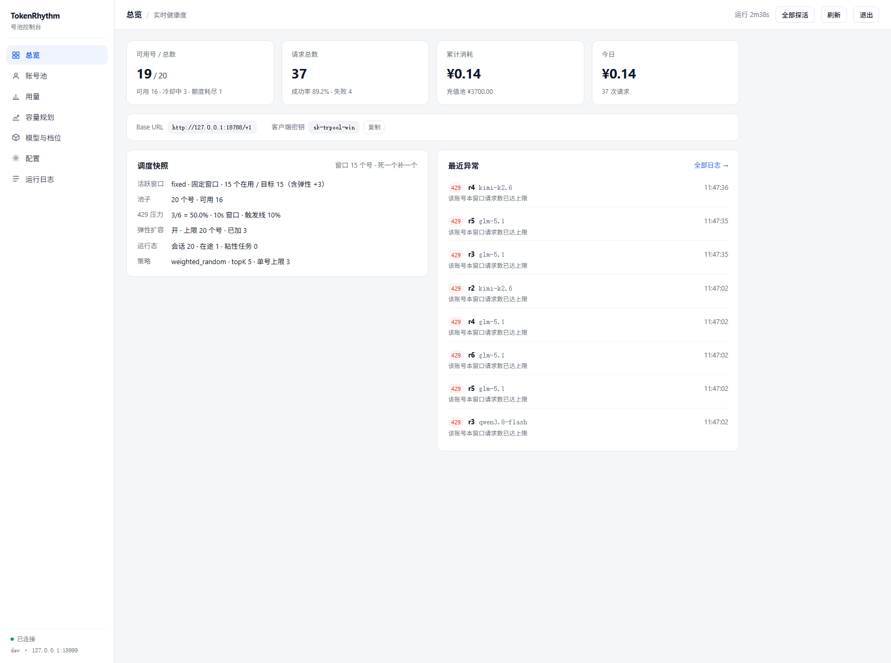
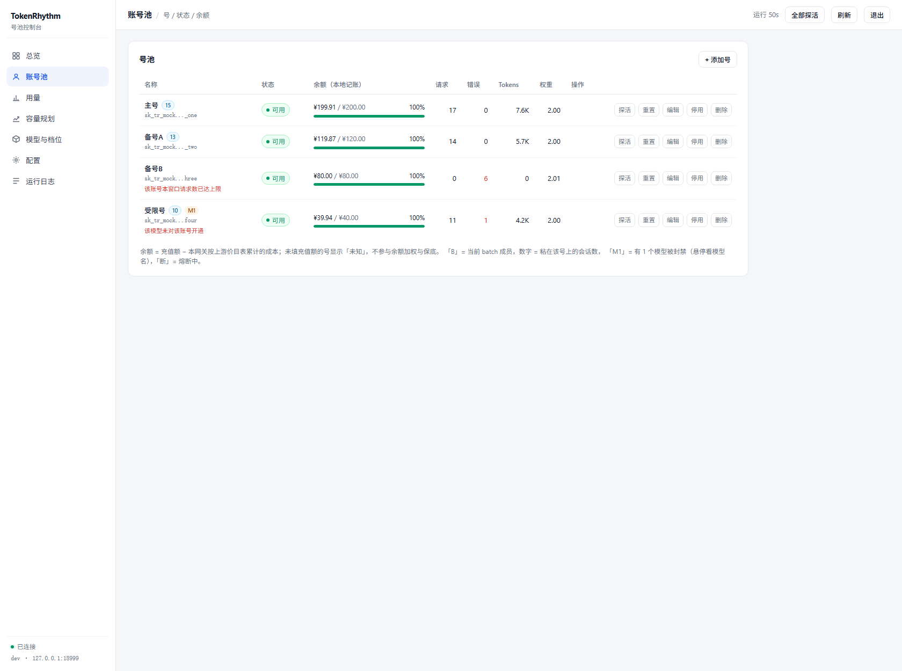
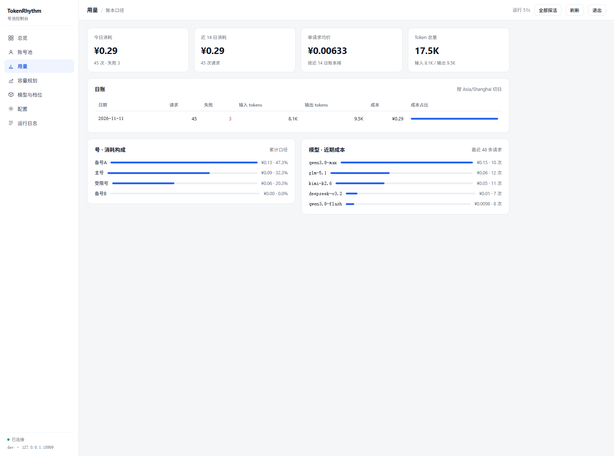
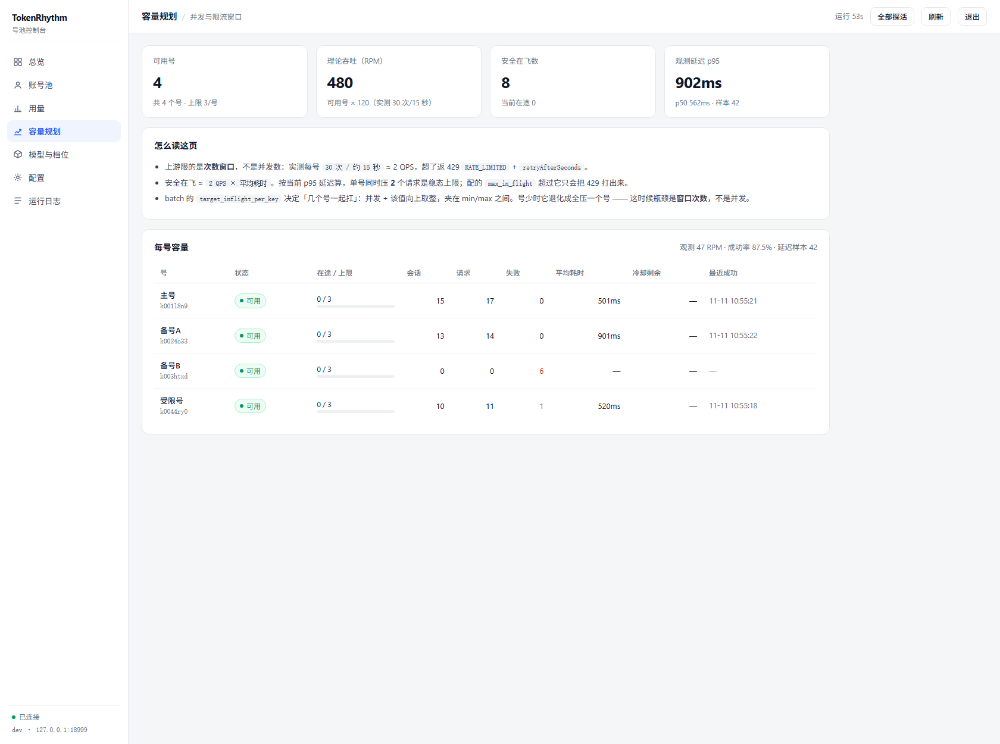
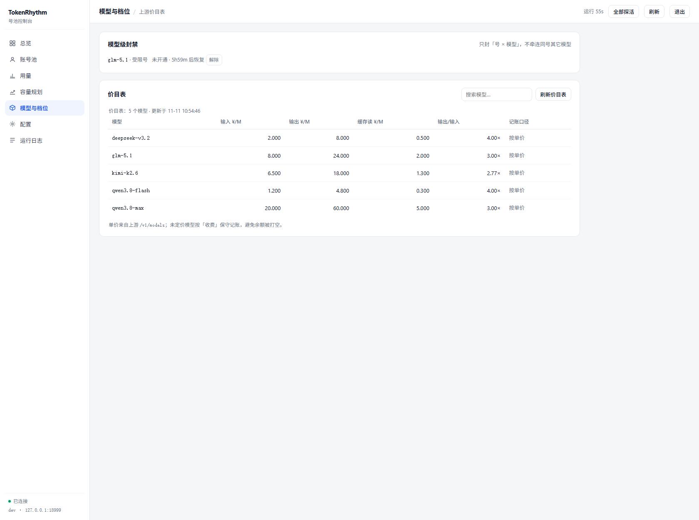
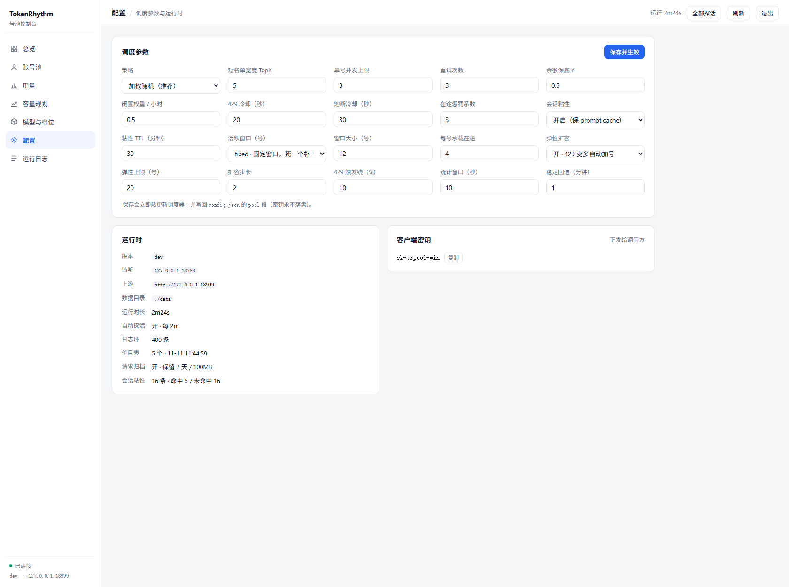
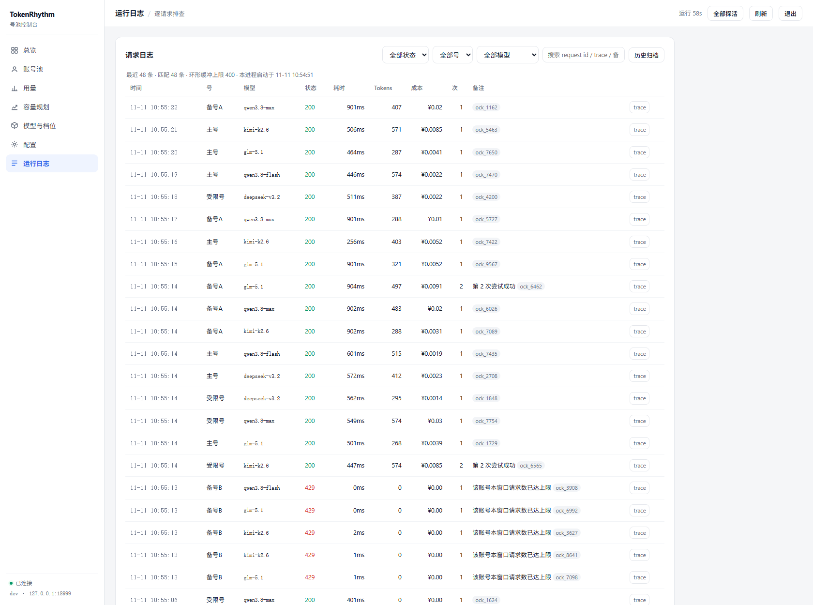

# trpool — TokenRhythm 号池网关

[](https://github.com/rsfree/tokenrhythm2api/releases)
[](LICENSE)

把多个 `sk_tr_` 密钥池化成一个入口：**客户端只认一把 key，网关负责选号、换号、冷却、记账。**

调度骨架来自 `workbuddy2api`（候选过滤 → 短名单加权抽签 → 熔断冷却 → 粘性会话 → 请求归档 → 容量规划），
但**整条逆向层被删掉了**：tokenrhythm 本身就是 OpenAI/Anthropic 兼容的纯 API，
不需要 OAuth 设备码、客户端指纹伪造、协议桥接、行为上报。剩下的只有一条主干：

```
鉴权 → 选号 → 透传 → 换号 → 记账
```

零外部依赖（`go.mod` 只有 module 声明）、单二进制、前端 `go:embed` 进可执行文件。

---

## 架构

```
                        ┌──────────────────────────────────────────┐
   client (sk-trpool-)  │  server: 鉴权 → body 限流 → 选号 → 透传  │
   ───────────────────► │            │            │            │   │
                        │            ▼            ▼            ▼   │
                        │      livecfg       pool(lease)     reqlog │
                        │   热更新密钥表   在途/冷却/粘性    环形+归档│
                        └────────────┬─────────────┬──────────────┘
                                     │             │
              ┌──────────────────────┴──┐   ┌──────┴───────────────┐
              │ upstream.Client         │   │ scheduler (5s tick)  │
              │ 单 http.Client、无重试  │   │ 探活 / 价目表 / 落盘  │
              └───────────┬─────────────┘   └──────┬───────────────┘
                          │                        │
                          ▼                        ▼
                 tokenrhythm.studio        data/state.json
                 (sk_tr_* 多账号)          data/requests/*.jsonl
```

组件边界刻意做窄，一个包只解决一件事：

| 包 | 职责 | 不知道什么 |
|---|---|---|
| `internal/upstream` | 收发 HTTP，构造/剥离头部 | 不知道有几个号、不知道该重试 |
| `internal/pool` | 号状态机、选号、冷却、熔断、粘性、活跃窗口与弹性 | 不知道 HTTP 长什么样 |
| `internal/fault` | 把状态码 + body 判成失败类别 | 不知道号的存在 |
| `internal/server` | 鉴权、重试循环、SSE 透传、记账 | 不知道号为什么被选出来 |
| `internal/reqlog` | 环形缓冲 + JSONL 归档 | 不知道调度策略 |
| `internal/scheduler` | 5s 巡检：探活、刷价目表、落盘 | 不参与请求路径 |

所以"换个上游"只改 `upstream`，"换套选号算法"只改 `pool`——两侧互不牵连。

---

## 快速开始

### 1. 首次启动会自动生成配置

```bash
go build -o trpool ./cmd/trpool
./trpool -config config.json
```

```
已生成默认配置 config.json（含随机密钥，权限 600）
  admin_key  = sk-trpadmin-8f3c1a...
  client_key = sk-trpool-2b9e04...
trpool dev 启动：listen=:8787 upstream=https://tokenrhythm.studio 号池=0 client_key=1
```

固定 `config.json` 里只有"能公开的东西"（策略、阈值、路径），密钥优先读环境变量：

```bash
export TRPOOL_ADMIN_KEY="sk-trpadmin-$(openssl rand -hex 12)"
export TRPOOL_CLIENT_KEYS="sk-trpool-$(openssl rand -hex 16)"
```

### 2. 灌号（池子非空时忽略，不会重复导入）

```bash
TRPOOL_KEYS="账号A=sk_tr_xxx=100,账号B=sk_tr_yyy=50" ./trpool -config config.json
#                                     ↑ 名称=密钥=充值额（¥，可省）
```

### 3. 打开面板

```bash
open "http://127.0.0.1:8787/panel"     # Bearer admin_key，也支持 ?token=<admin_key>
```

### Docker

```bash
export TRPOOL_ADMIN_KEY=... TRPOOL_CLIENT_KEYS=...
docker compose up -d                    # 自己构建
```

```bash
docker run -d --name trpool --restart unless-stopped \
  -p 8787:8787 \
  -e TRPOOL_ADMIN_KEY="sk-trpadmin-..." \
  -e TRPOOL_CLIENT_KEYS="sk-trpool-..." \
  -v "$PWD/data:/data/data" \
  ghcr.io/rsfree/tokenrhythm2api:latest
```

> 镜像 tag 与 git tag 同版本但**不带 `v` 前缀**（`v0.0.4` → `:0.0.4`），另有 `:latest` 和 `:sha-<7位>`，
> 三者来自同一次构建（digest 相同）。当前只构建 **linux/amd64**。

---

## 客户端接入

把 `base_url` 指到网关、`api_key` 换成 client key，协议完全透传：

```python
from openai import OpenAI

client = OpenAI(
    api_key="sk-trpool-xxxx",           # 网关下发的，不是 sk_tr_
    base_url="http://127.0.0.1:8787/v1",
)
print(client.chat.completions.create(
    model="qwen3.8-flash",
    messages=[{"role": "user", "content": "你好"}],
).choices[0].message.content)
```

| 协议 | 路径 |
|---|---|
| OpenAI | `/v1/chat/completions`、`/v1/embeddings`、`/v1/models` |
| Anthropic | `/v1/messages` |
| 视频 | `/v1/videos/generations`、`/v1/videos/{id}`、`/v1/videos` |
| 决策 | `/v1/decision`、`/v1/systemone` |

`stream: true` 按 SSE **逐行透传**，不改缓冲、不攒包；静默超过 `server.stream_keepalive`（默认 15s）
补一行 `: keepalive` 注释帧，防止中间反代按空闲超时掐断（SSE 规范里以 `:` 开头的行就是注释，SDK 会跳过）。

响应头带诊断信息，出问题不用翻日志也能定位：

| 头 | 含义 |
|---|---|
| `X-Trpool-Key` | 本次实际使用的号名 |
| `X-Trpool-Attempt` | 第几次尝试（1 = 一次成功） |
| `X-Trpool-Trace` | 上游 trace_id，对工单用 |
| `X-Trpool-Reason: model-denied` | 模型级封禁，换号也无解 |
| `X-Trpool-Error: upstream` | 换满 `retry_max` 仍未成功 |

---

## 调度

`Acquire` 的判定顺序，每一层解决一个具体问题：

| 优先级 | 规则 | 为什么 |
|---|---|---|
| ① 视频任务粘性 | `task_id → key`，查询必须回创建者，冷却中也回 | 上游只认创建者，换号就 404 |
| ② 同号重试 | 供应链限流（`UPSTREAM_RATE_LIMITED`）时优先回原号 | 换号救不了，退避后同号才有效 |
| ③ 全局在途上限 | 超过 `max_in_flight_global` 时排队等释放 | 防止把上游打出持续 429 |
| ④ 会话粘性 | 同一段对话尽量落在同一个号 | 命中上游 prompt cache |
| ⑤ 活跃窗口 | 只从窗口内的号里选（窗口自愈 + 429 弹性） | 集中使用少数号，让每个号更快用透 |
| ⑥ 权重抽签 | 短名单（`top_k`）内按权重随机 | 余额多的多用，久置的补偿 |
| ⑦ 兜底 | 全池冷却时挑"最早恢复"的号试一次 | 冷却是按时间恢复的，让真实请求去验证 |

越界即退出，不会层层叠加成"看起来选了 A 实际选了 B"。

### 会话粘性：省钱的那一项

上游各家的 prompt cache **按账号隔离**，会话一旦被打散到不同号，缓存永远命中不了。
价目表里的差价是实打实的：

| 模型 | 输入 | 缓存命中 |
|---|---|---|
| glm-5.1 | ¥8/M | ¥2/M |
| kimi-k2.6 | ¥6.5/M | ¥1.3/M |

指纹取法（按优先级）：

1. 显式会话标识 —— OpenAI 的 `user`、Anthropic 的 `metadata.user_id`、`conversation_id`
2. 否则用 `system` + 首条 `user` 的内容（`prefix_affinity`，默认开）

TTL 默认 30 分钟，表上限 2000 条（超了淘汰最久未用）。**粘住的号出事（冷却 / 余额触底 /
模型被封禁）会自动退让**，不会把会话卡死；下一次请求重新粘到能服务该模型的号上。

### 活跃窗口：100 个号只动用 12 个

号池大起来之后，"全池平分"是个陷阱：100 个号各摊 1% 的流量，每个号都慢慢热、
慢慢撞限流，谁也用不透；余额也是散在 100 个号上，跑空哪个都得单独补。

`fixed` 模式把号分成两层：

| 层 | 数量 | 作用 |
|---|---|---|
| 活跃窗口 | `size`（例：12） | 只有这些号参与派单 |
| 备胎 | 其余 | 待命，不消耗流量 |

窗口是**自愈**的，掉一个补一个：

```text
12 个在用 → 某个号 401/402/余额跑空 → 当场从备胎里补 1 个 → 仍是 12 个在用
```

补号时机不是"下一笔请求进来时"，而是**判定失效的那一刻**（`Release` / 记账 / 探活 /
5 秒巡检都会触发 `refreshBatchLocked`），中间不会出现"只剩 11 个能用"的空档。
余额判断看的是记账（`SpentCNY ≥ Budget`），不用等服务端返回 402。

面板总览的「活跃窗口」一行会直接写出 `12 个在用 / 目标 12` 和 `96 个号 · 可用 88`；
如果可用号本来就不够（比如 100 个号里有 95 个失效），会显示 `缺 N 个` 而不是假装健康。



> 20 个号、窗口 12：截图这一刻有 6 个号在 429 冷却 / 1 个欠费停用，
> 窗口已经弹性扩到 15，池子里可用 16——补号与扩容同时发生在同一次巡检里。

### 弹性：429 变多就多开，稳了再退

`batch.elastic.enabled` 打开后，窗口在 `[size, max_size]` 之间浮动：

| 信号 | 动作 |
|---|---|
| 窗口内 429 占比 ≥ `trigger_rate`（默认 15%），且样本够（≥ `min_samples`，或 ≥ `min_hits` 次 429） | `extra += step`，最多到 `max_size` |
| 连续 `stable`（默认 5 分钟）没有新的 429，且距上次扩容 ≥ `hold` | `extra -= decay_step`，退到 0 为止 |

两个防止抖动的约束：

- **一个统计窗口最多扩一次**（`window` 同时是最小间隔），否则一波"每个请求都撞 429"
  会连着几轮把池子拉到上限；
- **缩容只退空闲号**，且中间只要再出现 429 就立刻停手——不会刚退完又扩。

只统计**按号限流**的 429（上游 `RATE_LIMITED`）：那是这个号的次数窗口满了，多开号确实
能加总配额。`UPSTREAM_RATE_LIMITED`（模型侧限流）是全池共享的上游瓶颈，开更多号不加吞吐，
**不计入**——这种压力应该退避重试，不是加号。

### 三种模式怎么选

| 模式 | 行为 | 适用 |
|---|---|---|
| `off` | 全池参与，最均衡 | 号少（≤ 5 个），或额度互不相干 |
| `fixed` | 固定 `size` 个号，死一个补一个 | **号多（几十上百），想让少数号快速跑透** |
| `auto` | `target = ceil(在途并发 / target_inflight_per_key)`，夹在 `[min, max]` | 并发波动大，想让窗口跟着流量走 |

`fixed` 与 `auto` 都能叠加弹性；弹性只是把当前目标往上抬，退的时候回到基准。
缩容只挑空闲号，不会踢掉正在跑请求的号；batch 是软约束——成员全满或被 `tried` 排除时
自动放开到全池，不会把请求卡死。

### 防惊群

`min_pick_gap`（默认 100ms）内同一个号不会被重复选中，避免一波并发全砸在同一个号上；
全部号都刚用过时按 LRU（单调 `seq`）兜底，不会返回"没有可用号"。

### 预热

启动时并发探一遍所有启用的号（默认 4 并发），**探出坏号直接写进状态**，让第一波业务请求
不必自己试错。只打 `/v1/models`，不消耗生成额度。

实测：某次启动时两个号已被上游 `ACCOUNT_SUSPENDED` 冻结，预热直接判为 `exhausted`，
随后 3 个业务请求全部 `attempt=1` 一次成功。

---

## 容错

分类逻辑集中在 `internal/fault`：只看 `状态码 + body + Retry-After`，输出一个 `Verdict`，
由 `pool` 决定后果。**同一个状态码的不同 body 是不同的事**，这是整套容错的前提。

| 上游返回 | 类别 | 号的后果 | 是否换号 |
|---|---|---|---|
| 2xx | — | 失败计数清零，回到 `active` | — |
| 401 | `auth` | `invalid`，不自动恢复，需人工重置 | 是 |
| 402 | `quota` | `exhausted`，冷却 `exhausted_cooldown` | 是 |
| **403 + `ACCOUNT_SUSPENDED`** | `quota` | 同上（账号被冻结） | 是 |
| **403 + `MODEL_ACCESS_DENIED`** | `model_denied` | **只封「号 × 模型」**，6h 起指数退避 | 是 |
| 403 其它 | `quota` | 保守按冻结处理 | 是 |
| **429 + `RATE_LIMITED`** | `rate` | `cooling`，按 `retryAfterSeconds` 精确冷却 | 是 |
| **429 + `UPSTREAM_RATE_LIMITED`** | `upstream_rate` | **只冷「号 × 模型」**（30s），优先同号重试 | 是 |
| 429 无标记 | `rate` | 同上，无提示时 20s 起指数退避 | 是 |
| 5xx / 超时 | `upstream` | 连续 3 次熔断，30s 起指数退避 | 是 |
| 其它 4xx | `client` | **不罚号**，立即原样返回 | 否 |

### 模型级封禁（`(key, model)`）

这是相对"一撞 403 就冷却整个号"最关键的一处修正。`MODEL_ACCESS_DENIED` 是
**按号 × 按模型**生效的：A 号没开通 `glm-5.1`，不代表 A 号不能用 `kimi-k2.6`。

- 把账号冻结当成"模型没权限"不重试 → 会话粘在冻结号上，次次撞墙；
- 把模型没权限当成"号的锅"去冷却 → 调一次没权限的模型能把全池冷却掉。

所以封禁记在 `Key.ModelBlocks[]` 上，`usableFor(model)` 逐模型判定：

```
第 1 次 MODEL_ACCESS_DENIED → 封 6h
第 2 次（解除后又撞）      → 封 12h
第 3 次                    → 封 24h（cap）
任意一次该模型成功         → 立刻全部解除
```

同类逻辑用于 `UPSTREAM_RATE_LIMITED`：它换号也救不了（是模型供应链在限流），
所以只对 `(号, 模型)` 做 30s 短冷，退避后**优先回原号**。

封禁状态在账号池页以 `M 模型名` 药丸展示，可单条清除
（`DELETE /panel/api/keys/{id}/models?model=xxx`），不必重置整号。

### 熔断与冷却解耦

- **冷却**（`cooldown_until`）回答"这个号现在能不能用"，一次性事件（429、402、超时）触发。
- **熔断**（`breaker_until`）回答"这个号是不是持续在坏"，由 `FailStreak ≥ breaker_threshold` 触发。

两者独立计时：冷却到期就恢复派单，但熔断期间仍会被跳过。这样"偶发 429"不会把号永久打入冷宫，
"连续 5xx"也不会因为冷却到期就立刻满血复活。`RateStreak` 单独计数，
429 的退避次数不会被 `FailStreak` 污染（否则一串 429 会把号推成熔断）。

### 重试边界

**只有上游响应头已到、但还没向客户端写出任何字节时才换号。**
流式一旦开始刷字节就不再换——否则客户端会收到两个上游拼接的内容。

### 视频任务粘性

`POST /v1/videos/generations` 成功后记下 `task_id → key`，后续 `GET /v1/videos/{id}`
强制回到创建者，**即使那个号正在冷却**。粘性默认保留 72h（`sticky_ttl`）。

---

## 记账

上游**没有公开的余额查询接口**（`/v1/me`、`/v1/usage`、`/v1/balance` 全 404，响应头也无配额头），
所以余额只能反推：

```
剩余 = 充值额（人工填） − 累计成本（本地记账）
```

成本口径不靠估：优先取上游响应里的 `cost_cny` / `billing.total_cost_cny`（结算口径），
没有时用 `/v1/models` 自带的单价 × usage 计算。实测两者完全一致：

| 请求 | usage (prompt/completion) | 本地按单价算 | 上游 `cost_cny` |
|---|---|---|---|
| 非流式 | 65 / 16 | ¥0.00004760 | ¥0.00004760 |
| 流式 | 68 / 32 | ¥0.00007040 | ¥0.00007040 |

价目表里缓存读有独立单价，所以公式不是简单相乘：

```
cost = (prompt − cached) × input + cached × cache_read + completion × output   （单价按 /M token）
```

几个刻意的选择：

- **没填充值额的号**余额显示"未知"，不参与余额加权，也不触发保底——适合先跑起来再补数据。
- **未知模型按"收费"处理**（保守），避免刷新失败期间把余额打空。
- **日账一个请求只记一次**（重试不重复计费），但**日志每次尝试都留一条**，方便区分"贵"和"重试多"。
- 日账按 `Asia/Shanghai` 切日（Dockerfile 里装了 tzdata，否则跨零点会算到前一天）。

余额触底（`credit_floor`，默认 ¥0.5）后号码停止派单（`exhausted`）；
面板里补一笔充值额（`POST /panel/api/keys/{id}/budget {delta}`）会自动复活。

---

## 请求日志与归档

两层，用途不同：

| 层 | 位置 | 默认量 | 用途 |
|---|---|---|---|
| 环形缓冲 | 内存 + `state.json` | 最近 400 条 | 面板实时看，"刚才那个 429 是谁打的" |
| 归档 | `data/requests/requests-YYYY-MM-DD.jsonl` | 7 天 / 100MB | 跨重启查历史、按号/模型回溯 |

归档只写**元数据**（时间、号、模型、状态、耗时、tokens、成本、trace_id、客户端 IP/UA），
**不写提示词、不写响应正文、不写任何凭证**——这是能长期开着的前提。
写盘按 32 条一批 flush，`retention_days` 与 `request_archive_max_mb` 任一超限就按天淘汰旧文件；
面板查询前会先 flush 一次，所以"刚发生的那一条"切过去就能看到，不用等下一批。

**选不到号也会留一条记录**（`503 NO_CAPACITY`，号名为空）：池空了、全部冷却、全部 401 失效，
是最需要人介入的故障，不该在面板上完全静默。

日志页右上角「历史归档」按钮切成归档模式（服务端过滤，因为归档可能有几十万行）。

---

## 面板

`/panel`（Bearer `admin_key`，也支持 `?token=<admin_key>` 浏览器直开）。左侧导航七页，窄屏收成抽屉。

| 总览 | 账号池 |
|---|---|
|  |  |

| 用量 | 容量规划 |
|---|---|
|  |  |

| 模型与档位 | 配置 |
|---|---|
|  |  |



> 截图数据来自本地假上游（`docs/screenshots` 里的密钥与号名均为演示用），
> 刻意造了 429 冷却、402 额度不足、403 模型未开通、换号重试四类现场；
> 总览页那张是「20 个号 / 固定窗口 12 / 弹性扩到 15」的实时状态。

| 页 | 解决什么 |
|---|---|
| **总览** | 可用号/请求/消耗/今日四张卡；调度快照（活跃窗口 `在用/目标`、池子可用数、窗口内 429 占比与触发线、弹性余量、会话/在途/粘性）；**最近异常**——失败请求按时间倒序，带状态码、号名、模型与上游原话 |
| **账号池** | 状态、余额进度条、请求/错误/Token、当前权重、最后错误；`B` = 当前活跃窗口成员，数字 = 粘在该号上的会话数，`M 模型` = 模型级封禁。操作：探活、重置、编辑、启停、删除、补额度、解除单模型封禁；**添加号** 支持「单个 / 批量」——批量页把整列密钥粘进文本框即可，一行一个 |
| **用量** | 今日/近 14 日消耗、单请求均价、Token 总量；日账表；**号 · 消耗构成** 与 **模型 · 近期成本** |
| **容量规划** | 可用号数、理论 RPM（`key_qps × 60 × 可用号`）、安全在飞数（`ceil(key_qps × p95)`）、观测 p95 与实测 RPM；每号容量表。**这页是判断"要不要加号"的依据** |
| **模型与档位** | 上游价目表：输入/输出/缓存读单价、是否按单价记账；搜索 + 一键刷新；**模型级封禁**列表（哪个号在哪个模型上被封、还剩多久、一键解除） |
| **配置** | 调度参数热更新（保存即生效并写回 `config.json` 的 `pool` 段）：搜索策略、活跃窗口模式/大小、弹性扩容（开关/上限/步长/触发线/统计窗口/稳定回退）；运行时只读信息；客户端密钥查看与复制 |
| **运行日志** | 逐请求记录；按状态（全部/仅失败/仅成功）、号、模型、文本过滤；每条带耗时、tokens、成本、第几次尝试、备注，`trace` 按钮复制 trace_id。可切「历史归档」跨重启查 |

### 批量加号

账号池 → 右上角「+ 添加号」→ 切到「批量」，把密钥整列粘进去：

```
sk_tr_xxxxxxxx
sk_tr_yyyyyyyy
主账号=sk_tr_zzzzzzzz          ← 「=」、逗号、制表符、空格都能分名称
# 这一行会被跳过
```

- 只给密钥的行按 **名称前缀 + 序号** 自动命名（前缀留空则 `key-<池内条数+1>` 起）；
  也可在批量页填「统一充值额」，一次给整批号记同一个本金。
- **一行失败不影响其它行**：非法形态、池中已有、本批重复都会被单独跳过，失败行号与原因直接列在表单下方；
  已经进池的号不会被重复提交加出第二份（重复密钥一律跳过）。
- 单次上限 500 个。导入后立刻参与活跃窗口，不用等下一笔请求才补齐。

同一个接口给脚本用：

```bash
curl -X POST "https://trpool.1task.cn/panel/api/keys/batch" \
  -H "Authorization: Bearer $TRPOOL_ADMIN_KEY" -H 'Content-Type: application/json' \
  -d '{"secrets":"sk_tr_a\nsk_tr_b","name_prefix":"tr-","budget":100}'
# → {"ok":true,"total":2,"added":2,"skipped":0,"results":[{"line":1,"name":"tr-1","id":"..."},...]}
```

排查动线：**总览看异常 → 点号名看该号状态 → 运行日志按号过滤看时间线 → 容量规划判断是不是撞了窗口**。

管理接口（均需 `Authorization: Bearer <admin_key>`）：

```
GET    /panel/api/state
GET    /panel/api/logs?n=400[&history=1&key=&model=&errors=1&q=]
GET    /panel/api/capacity
GET    /panel/api/models
POST   /panel/api/keys              {name, secret, weight, budget}
POST   /panel/api/keys/batch        {secrets, name_prefix?, budget?, weight?}   # 每行一个，可「名称=密钥」
PATCH  /panel/api/keys/{id}         {name?, secret?, weight?, budget?, enabled?}
DELETE /panel/api/keys/{id}
POST   /panel/api/keys/{id}/reset               # 清冷却/熔断/封禁/失败计数
POST   /panel/api/keys/{id}/probe               # 单号探活
POST   /panel/api/keys/{id}/budget  {delta}     # 调整充值额（¥）
DELETE /panel/api/keys/{id}/models?model=xxx    # 解除单模型封禁
POST   /panel/api/keys/probe                    # 全池探活
PUT    /panel/api/pool                          # 热更新调度参数
POST   /panel/api/prices                        # 刷新价目表
GET    /panel/api/config                        # 运行时信息
```

另外两个非面板端点：`GET /healthz`（无鉴权，容器探针用）、`GET /status`（需 admin，JSON 快照）。

---

## 配置

完整示例见 [`config.example.json`](config.example.json)。文件里**只放能公开的东西**，
面板改调度参数时只替换 `pool` 段（`config.WritePool`），不会把密钥写进文件。

### 环境变量

| 变量 | 作用 |
|---|---|
| `TRPOOL_ADMIN_KEY` | 面板/管理接口令牌（**必填**，或写在配置文件） |
| `TRPOOL_CLIENT_KEYS` | 下发给客户端的密钥，逗号分隔（**必填**） |
| `TRPOOL_UPSTREAM` | 上游地址，默认 `https://tokenrhythm.studio` |
| `TRPOOL_LISTEN` | 监听地址，默认 `:8787` |
| `TRPOOL_DATA_DIR` | 数据目录，默认 `./data` |
| `TRPOOL_BODY_LIMIT_MB` | 请求体上限，默认 64 |
| `TRPOOL_KEYS` | 首启灌号：`名称=密钥=充值额,...`（池子非空时忽略） |

### 主要参数

| 键 | 默认 | 说明 |
|---|---|---|
| `pool.strategy` | `weighted_random` | `weighted_random` / `round_robin` / `sequential` |
| `pool.top_k` | 5 | 加权抽签的短名单宽度（1 = 永远选最强，越大越分散） |
| `pool.max_in_flight` | 3 | 单号在途上限 |
| `pool.max_in_flight_global` | 0 | 全池在途上限（0 = 不限） |
| `pool.breaker_threshold` | 3 | 连续失败多少次熔断 |
| `pool.rate_cooldown` / `_max` | 20s / 10m | 429 冷却起点与上限 |
| `pool.exhausted_cooldown` | 30m | 402/冻结的冷却 |
| `pool.model_block_base` / `_max` | 6h / 24h | 模型级封禁的指数退避区间 |
| `pool.model_rate_cooldown` | 30s | 供应链限流的 `(号, 模型)` 短冷 |
| `pool.credit_floor` | 0.5 | 余额低于此值且模型收费则不派单（0 = 关闭） |
| `pool.retry_max` | 3 | 单请求最多换几个号 |
| `pool.min_pick_gap` | 100ms | 同号重复选中最小间隔（防惊群） |
| `pool.fallback_probe` | true | 全池冷却时允许挑最早恢复的号试一次 |
| `pool.key_qps` | 2 | 每号上游配额（只用于容量页估算，不参与选号） |
| `pool.session_sticky.*` | 开/30m/2000 | 会话粘性开关、TTL、表上限、前缀亲和 |
| `pool.batch.*` | fixed/12/1/0/4 | 活跃窗口模式、窗口大小、上下限、auto 的并发换算基准 |
| `pool.batch.elastic.*` | 开/60s/15%/20/2/0/2m/5m/1 | 弹性扩容：开关、统计窗口、429 触发线、最小样本与最小命中数、步长、上限、保持时长、稳定回退时长、回退步长 |
| `server.stream_keepalive` | 15s | SSE 心跳间隔（0 = 关闭） |
| `server.body_limit_mb` | 64 | 请求体上限，超了返 413 |
| `logging.ring_size` | 400 | 内存日志条数 |
| `logging.request_archive` | true | JSONL 归档开关 |
| `logging.retention_days` / `request_archive_max_mb` | 7 / 100 | 归档淘汰阈值 |
| `auto_probe.interval` | 2m | 对 `cooling`/`invalid` 号的探活间隔 |
| `prices.refresh_interval` | 10m | 价目表刷新间隔 |

---

## 运维要点

- **状态文件**：`data/state.json`（号、账本、粘性、最近 200 条日志），权限 600，原子写
  （临时文件 + rename）。内存环是 400 条，只落 200 条——状态文件要小，长期历史交给归档。
  删掉它会丢历史账本，号会随配置文件重建。
- **优雅停机**：`SIGTERM` 后先 `Shutdown`（预算 `server.shutdown_timeout`，默认 10s）再落盘再关归档，
  正在跑的流式请求有机会写完最后一个 token。
- **并发上限的真相**：tokenrhythm 的限制是**每号 30 次/约 15 秒滑动窗口（≈2 QPS）**，不是并发数。
  实测 31 并发时正好 30 过 1 拒，而当时串行的 6 个也会被拒。所以安全在飞数 ≈ `2 × 响应耗时`，
  1.5s 响应时约 3 个；超了返 429 `RATE_LIMITED` + `retryAfterSeconds`（13~15s 自愈），
  网关按它精确冷却——这就是 `max_in_flight=3` 与 `key_qps=2` 的来源。
- **`include_usage` 注入**：流式 `/v1/chat/completions` 会强制 `stream_options.include_usage=true`，
  否则拿不到 usage、记账只能估算。多出来的那个 usage chunk 是 OpenAI 官方语义，SDK 会正常忽略。
- **热更新令牌**：`livecfg` 用 `atomic.Pointer` 存快照，改密钥不需要重启；
  密钥比较走 SHA-256 摘要 + `subtle.ConstantTimeCompare`，避免按字节比较泄漏长度与时序。

---

## 目录

```
cmd/trpool/          入口：配置加载、组件装配、优雅停机
internal/config/     配置结构、校验、默认值、pool 段回写
internal/livecfg/    热更新快照（admin/client key、开关）
internal/httpauth/   Bearer / x-api-key 校验（恒定时间比较）
internal/fault/      状态码 + body → 失败类别
internal/upstream/   上游传输层（只负责收发，不含重试）
internal/pool/       号池核心：状态机、选号、冷却、熔断、封禁、粘性、活跃窗口与弹性
internal/session/    会话指纹与粘性表（TTL + LRU）
internal/usage/      usage 解析、价目表、成本、日账
internal/reqlog/     请求日志环 + JSONL 归档
internal/capacity/   容量推算（p50/p95、安全在飞、RPM）
internal/server/     网关：鉴权 → 选号 → 透传 → 换号 → 记账
internal/panel/      管理 API + 内嵌前端（go:embed）
internal/scheduler/  后台巡检：探活、刷价、落盘
```

---

## 已知限制

- 余额是**本地记账推算**，不是上游真实余额。充值/退款/赠送额需要手动改充值额校准。
- 未知模型按"收费"处理（保守），避免刷新失败期间把余额打空。
- 没有接入用户体系：`client_keys` 是静态列表，适合个人或小团队内部用。
- 单实例设计，多副本会各记各的账、粘性表也不共享（归档目录各自独立）。
- 模型级封禁是**本地推断**：上游解除封禁后网关不知道，只能等退避到期或面板手动清除；
  到期后的第一次真实请求会验证并自动清空。
